# mkTV

**A web browser built for the TV remote.** By [MKTVHub](https://github.com/MKTVHub).

mkTV turns the D-pad into a fast way to use any website: the highlight jumps from link to link like a TV app, videos take over the remote when they play, and ads, pop-ups and hostile redirects are blocked by default. It runs on Android TV and Google TV today, with Fire TV, LG webOS and Samsung Tizen on the [roadmap](docs/ROADMAP.md).

[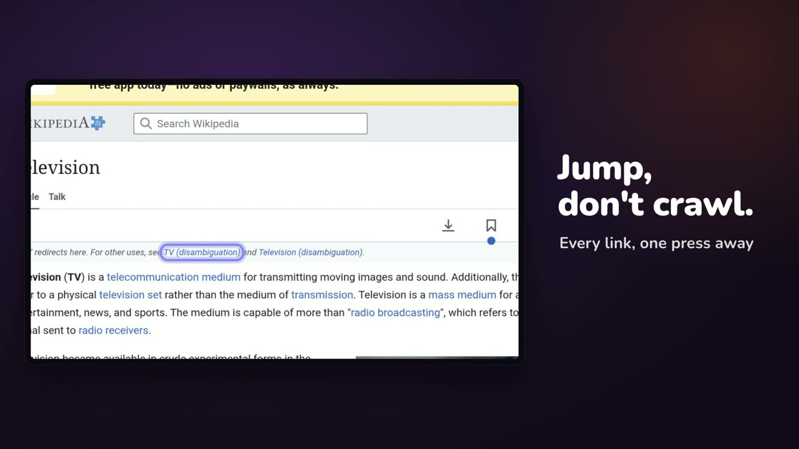](https://mktvhub.github.io/assets/mktv-promo.mp4)

<p align="center"><a href="https://mktvhub.github.io/assets/mktv-promo.mp4">▶ Watch mkTV in 40 seconds</a> · <a href="https://github.com/MKTVHub/mkTV/releases/latest/download/mkTV.apk">⬇ Download the APK</a> · <a href="https://mktvhub.github.io">mktvhub.github.io</a></p>

## Features

- **Jump navigation.** ▲▼◀▶ move a highlight between links and buttons; OK clicks, hold OK to long-press. Hold ▼ or ▲ to jump to a site's fixed bottom or top bar. Prefer a mouse? Switch to **pointer mode**, with Slow / Normal / Fast speed.
- **Out of the way.** The top bar hides while you browse and comes back when you need it.
- **Home screen.** Continue watching, Popular sites, your Favourites and Recently visited, one press away, one row each (Favourites has **Show all**). Edit Popular, hide or reorder sections, and rename, reorder and group Favourites into folders right on the TV.
- **Continue watching.** Long videos remember where you stopped, on any site. Pick up from Home, or from the **Play Next** row on your Android TV home screen. Never in private browsing; turn it off in Settings → Privacy.
- **Tabs.** Up to six live tabs (more sleep and reload when you return). A pop-up you clicked opens in a new tab; Back on its first page closes it and returns you. Switch from ⋮ → Tabs or by holding Menu. Background tabs are muted. Links opened from other apps arrive in a new tab of the one running mkTV.
- **Smart address bar.** Choose Google, DuckDuckGo, Bing, Brave or Startpage. As you type, it suggests matching Favourites and History pages, plus search suggestions from your engine if you turn them on (off by default, never in private browsing).
- **Voice search.** Press the mic in the toolbar and say a search or a website.
- **History.** Every page you've opened, grouped by day, searchable and remote-friendly. Remove single pages or clear it all.
- **Downloads.** Download files from sites after a quick confirm, follow progress in ⋮ → Downloads, then open them: APKs go to Android's installer, videos play in mkTV. No storage permission needed.
- **Updates in the app.** When a new release is out, the home screen offers it. One press downloads it from GitHub and opens Android's installer.
- **YouTube on the TV interface.** The YouTube tile opens YouTube's own TV interface, with the remote passed straight through.
- **Watch mode.** When a big video plays, the remote controls it: seek, pause, next/previous in vertical feeds, ▼ for full screen, ▲ for speed (remembered per site) and a sleep timer. Where a site's player can't go full screen, mkTV fills the screen with the video itself. Videos start with sound.
- **Page zoom.** Make any site bigger or smaller from ⋮ → Zoom; remembered per site, with a default in Settings.
- **Native player.** If a page plays an HLS or DASH stream, **Watch full screen** opens it in a native player that is smoother on TV hardware: a progress bar with the time it ends at, faster seeking while ◀/▶ is held, and subtitle and speed buttons.
- **Blocking.** Ads and trackers (built-in list plus the StevenBlack hosts list; turn on OISD, HaGeZi, Peter Lowe's or StevenBlack variants, add any hosts or domain list by address, and allowlist domains that must never be blocked), invisible click-trap layers, pop-ups and redirects you didn't click. Each block shows a small notice with **Open anyway** (press ▼ to reach it). Pause blocking for one site from the shield.
- **YouTube ad removal** using the same technique as uBlock Origin and Brave.
- **Private browsing.** A separate session that is deleted when you close it. Tracking codes are stripped from links and Global Privacy Control is on.
- **Phone remote.** Scan a QR code and use your phone's browser as a remote: D-pad or touchpad, live typing, your Home tiles, a seek bar for the playing video (in the native player too), volume and page scroll, **Add to Favourites** for the page on the TV, and a **Jump / Pointer** switch for how the remote moves around pages. The QR code carries a 128-bit pairing code that stays valid until you press **New code**, which unpairs every phone. The **Devices** tab lists connected phones with **Disconnect**, the TV shows a notice when a new phone connects, and Settings has an on/off switch.
- **Parental controls.** A 4-digit PIN for Settings, private browsing, downloads and the phone remote; Safe search for Google, Bing and DuckDuckGo; and sites that never load, in any tab.
- **Share Wi-Fi.** Show a QR code that guests scan to join your Wi-Fi.
- **Settings** in a sidebar of sections: Navigation, Start screen, Search, Protection, Blocklists, Privacy, Parental controls, Phone remote, Browsing, Downloads, Updates.

Full list with details and limits: [docs/FEATURES.md](docs/FEATURES.md).

## Remote controls

| Where | Key | Does |
|---|---|---|
| Page (jump mode) | ▲▼◀▶ | Move the highlight |
| | OK / hold OK | Click / long-press |
| | Hold ▼ / hold ▲ | Jump to the site's bottom / top bar |
| | ▲ at the top | Go to the toolbar |
| Page (pointer mode) | ▲▼◀▶ | Move the pointer; push an edge to scroll |
| Any page | Menu / hold Menu | Open the ⋮ menu / the tab switcher |
| | CH+ / CH− | Scroll up / down |
| | Play/Pause, FF, REW, Next, Prev | Control the page's video |
| Watch mode | ◀ ▶ | Seek 10 s |
| | OK | Pause / play |
| | ▲ ▼ | Previous / next (vertical feeds) |
| | ▼ | Full screen (normal video) |
| | ▲ (normal video) / hold OK | Playback controls: ±10 s, speed, sleep timer |
| | Back | Leave full screen, then browse the page again |
| YouTube TV | All keys | Go to YouTube; **hold Back** for the mkTV home screen |
| Address bar | ▼ | Move into the suggestions (press Back first to close the on-screen keyboard) |
| Anywhere | Search (if the remote has it) | Voice search |
| | Back | Close what's open, go back; at the start of a page's history, mkTV Home; on that Home, press twice to exit |

## Install

**From a release:** download [`mkTV.apk`](https://github.com/MKTVHub/mkTV/releases/latest/download/mkTV.apk) from the [latest release](https://github.com/MKTVHub/mkTV/releases/latest) and install it with a side-loading app (for example Downloader or Send Files to TV), or [from a computer over Wi-Fi](#install-from-a-computer-over-wi-fi). Release APKs are signed by MKTVHub; the certificate SHA-256 is `16:45:35:90:AA:A7:BD:7E:86:EC:B1:BD:E8:CC:8E:B9:AE:66:F3:30:CB:7C:BE:DC:72:3D:5F:3A:E5:BE:B7:FD`.

**From source** (JDK 17, Android SDK 35):

```sh
git clone https://github.com/MKTVHub/mkTV.git && cd mkTV
./gradlew test assembleDebug
adb connect <tv-ip>:5555
adb install -r app/build/outputs/apk/debug/app-debug.apk
```

The app appears on the TV home screen as **mkTV**. Package: `com.mktvhub.mktv`. Requires Android 7.0 (API 24) or newer.

Build-time default in `app/build.gradle.kts`: `DEFAULT_HOME_URL` (home page address, `https://www.google.com`), changeable in Settings. The built-in filter lists are in `FilterLists.PRESETS`.

## Install from a computer over Wi-Fi

No USB cable and no Play Store needed. You need a computer on the same Wi-Fi as the TV, with [Android platform-tools](https://developer.android.com/tools/releases/platform-tools) (`adb`) installed: on a Mac `brew install android-platform-tools`, on Windows `winget install Google.PlatformTools`.

### 1 · Unlock Developer options *(once)*

> **Settings → System → About** → select **Android TV OS build** and press **OK 7 times**
>
> ✅ *"You are now a developer"*

<sub>Older Android TV: **Settings → Device Preferences → About → Build**.</sub>

### 2 · Turn on debugging

> **Settings → System → Developer options**
>
> 🔘 **USB debugging** → On
> 🔘 **Wireless debugging** → On → **Allow**

<sub>No "Wireless debugging" (Android 10 or older)? Turn on **Network debugging** or just **USB debugging**, then skip to step 4 and use port `5555`.</sub>

### 3 · Pair the computer *(once)*

> **Wireless debugging → Pair device with pairing code**
>
> The TV shows an address like `192.168.0.5:37123` and a 6-digit code.

```sh
adb pair 192.168.0.5:37123      # type the 6-digit code when asked
```

### 4 · Connect

> Back on the **Wireless debugging** screen, note **IP address & Port** (a different port from step 3).

```sh
adb connect 192.168.0.5:41099
```

### 5 · Install mkTV

```sh
curl -LO https://github.com/MKTVHub/mkTV/releases/latest/download/mkTV.apk
adb install -r mkTV.apk
```

> If the TV asks **"Allow debugging?"** → tick **Always allow** → **OK**.
>
> ✅ **mkTV** appears in the TV's apps row. Updates after this happen inside the app (⋮ → About mkTV).

<sub>Done? You can switch **Wireless debugging** off again. Pairing is remembered for next time.</sub>

## Help & troubleshooting

### Phone remote: "This site can't be reached"

| Check | What to do |
|---|---|
| 📶 **Same network** | The phone's IP must start like the TV's (shown on the QR panel, e.g. `192.168.0.…`). Mesh routers and extenders often have separate 2.4 GHz / 5 GHz / guest names: join the exact one the TV is on. |
| 🛡️ **VPN on the TV** | mkTV works with VPNs. Most (NordVPN, Proton, Surfshark…) keep the home network outside the tunnel. If the QR panel shows a ⚠ VPN warning, turn on **Allow LAN / local network access** in the VPN app, or exclude mkTV with split tunneling. |
| 🛡️ **VPN or ad-blocker on the phone** | Pause it, or allow local network access in it. |
| 📱 **Mobile data** | Turn off "Wi-Fi assist" / "Switch to mobile data" so the phone uses Wi-Fi. |
| 🔒 **Router isolation** | Some routers block Wi-Fi devices from seeing each other ("AP / client isolation", common on guest networks). Turn it off, or use the main network. |
| 🔐 **Chrome switches to https://** | mkTV refuses https instantly so Chrome falls back to http. If Chrome shows "This site doesn't support a secure connection", tap **Continue to site**. Still stuck: Chrome **Settings → Privacy and security → Always use secure connections** → off, or "public sites only". |
| 🔁 **Old link** | The code stays the same until someone presses **New code** (or Disconnect on the Devices tab, which shuts out that phone until the next New code). If in doubt, scan the QR that's on the TV now. The address starts with `http://`, not `https://`. |

### Share Wi-Fi doesn't fill in the network name

Android reveals the Wi-Fi name only to apps allowed to use location, **and** only while **Location** is on (TV **Settings → Privacy → Location**). Or just type the name once; it's remembered.

### Netflix, Prime Video or Disney+ won't play

mkTV allows copy-protected (DRM) video, but these services decide what a browser may play. Some limit the quality or block TV browsers; their own TV apps work best.

### "This update is signed differently"

You installed a self-built copy (debug key). Install the release APK once over it after uninstalling, or keep updating from source.

### Still stuck?

[Open an issue](https://github.com/MKTVHub/mkTV/issues/new) with your TV model, Android version and what you see.

## Screenshots

| | |
|---|---|
| 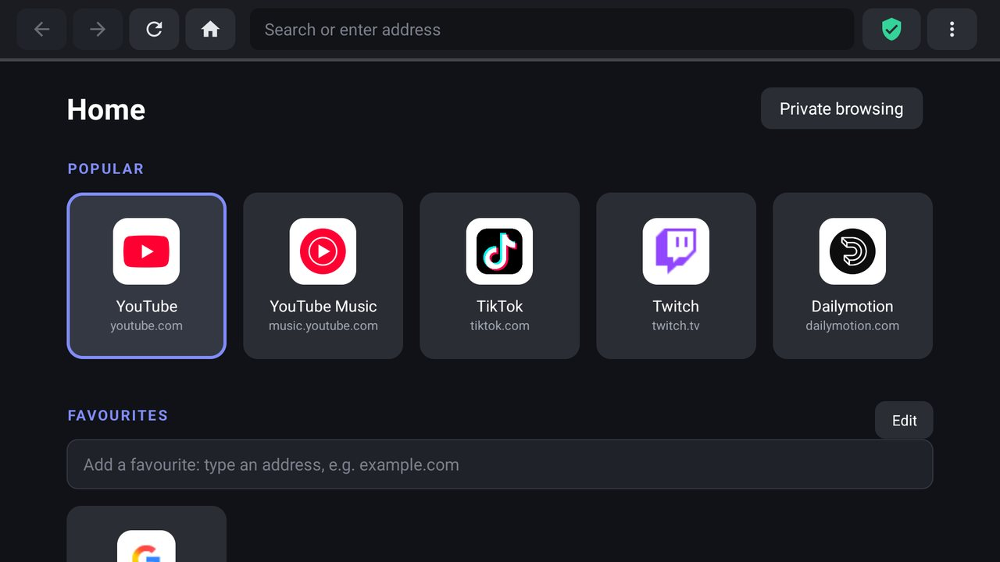 **Home screen**: mkTV logo, Popular and Favourites | 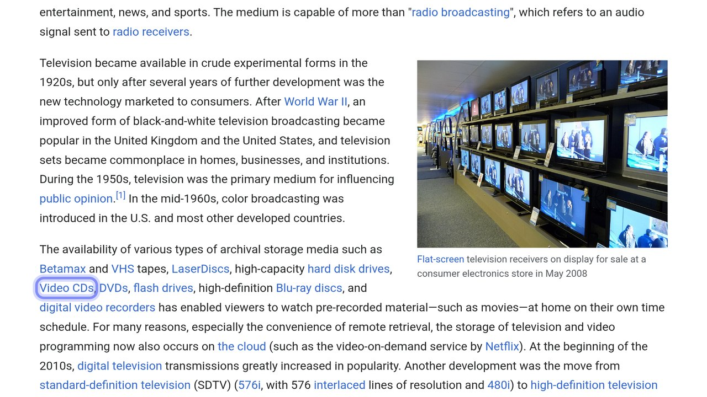 **Jump navigation**: the highlight jumps between links and buttons |
| 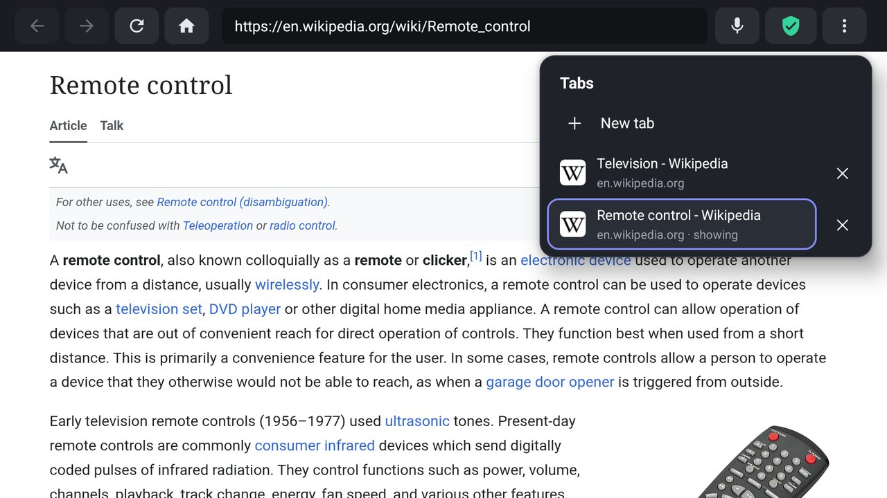 **Tabs**: switch or close from ⋮ → Tabs | 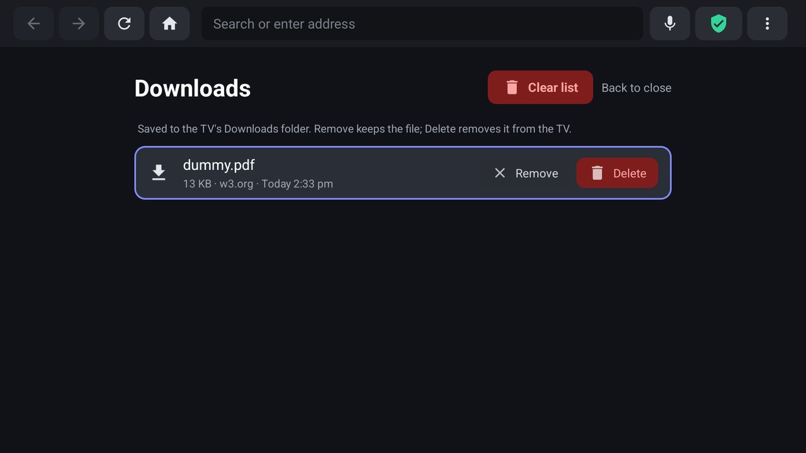 **Downloads**: open, remove or delete |
| 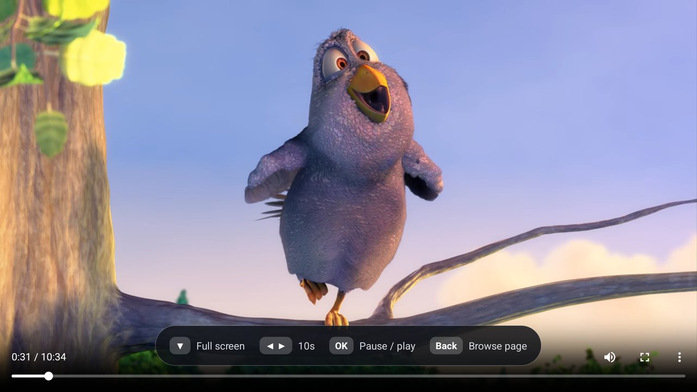 **Watch mode**: remote key hints over a playing video | 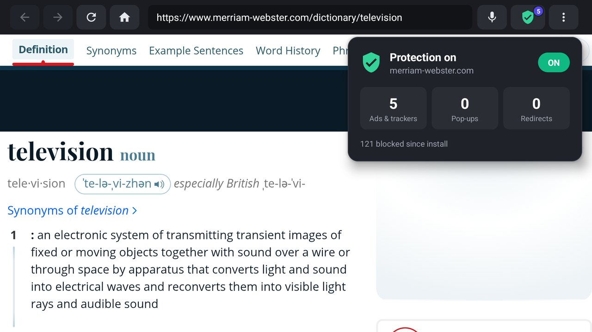 **Ad blocker**: what was blocked on this site |
| 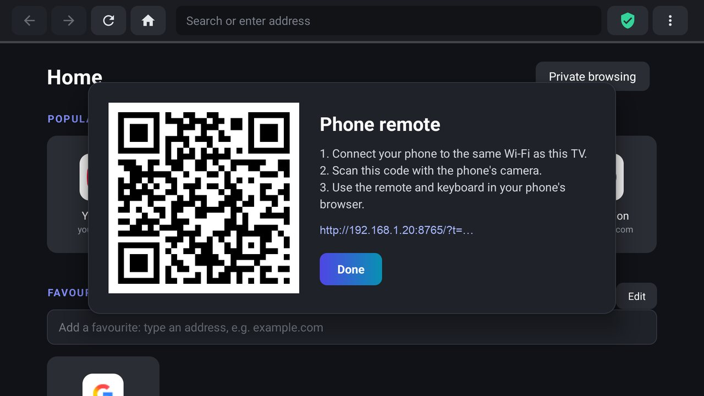 **Phone remote**: scan to pair; Connect and Devices tabs | 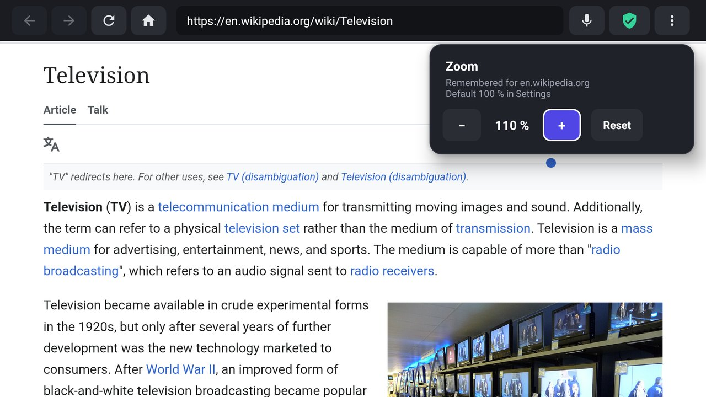 **Page zoom**: remembered per site |
| 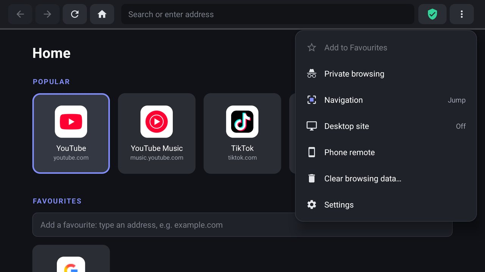 **⋮ menu**: Tabs, Zoom, Downloads and more | 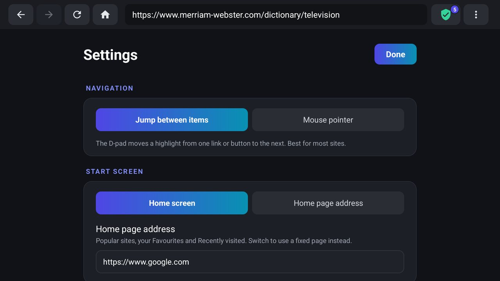 **Settings**: a sidebar of sections |
| 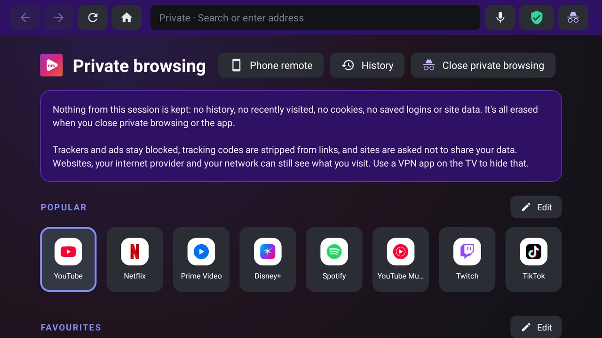 **Private browsing** | |

<p align="center">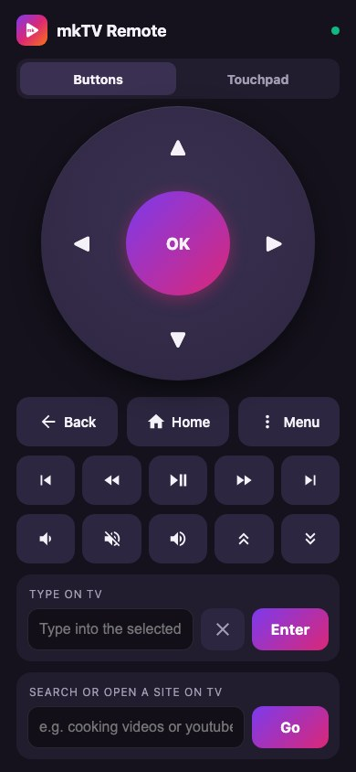<br><b>The phone remote</b>, in any phone browser</p>

<sub>Example content: Wikipedia (CC BY-SA), Merriam-Webster, "Big Buck Bunny" © Blender Foundation (CC BY 3.0). Site names and logos belong to their owners.</sub>

## Documentation

- [docs/FEATURES.md](docs/FEATURES.md): every feature, how it works, limits
- [docs/ARCHITECTURE.md](docs/ARCHITECTURE.md): native shell, injected JS, key routing
- [docs/PHONE_REMOTE.md](docs/PHONE_REMOTE.md): phone remote protocol and security
- [docs/PRIVACY.md](docs/PRIVACY.md): what is stored and sent, private mode limits
- [docs/ROADMAP.md](docs/ROADMAP.md): release checklist, next features, other TV platforms
- [docs/PLAY_STORE.md](docs/PLAY_STORE.md): Google Play (Android TV) requirements, permissions and policy notes
- [AGENTS.md](AGENTS.md): guide for contributors and AI coding agents
- [CONTRIBUTING.md](CONTRIBUTING.md)

## Privacy in one paragraph

No accounts, no analytics, no telemetry. mkTV itself only downloads the blocklists you have on and site icons for your home screen. Private browsing keeps nothing after you close it, but it does not hide your traffic from websites or your internet provider. Details: [docs/PRIVACY.md](docs/PRIVACY.md).

## License

Apache License 2.0. Copyright 2026 MKTVHub. See [LICENSE](LICENSE) and [NOTICE](NOTICE).

mkTV is a general-purpose web browser. You are responsible for the sites you visit and for following their terms and the law where you live.
